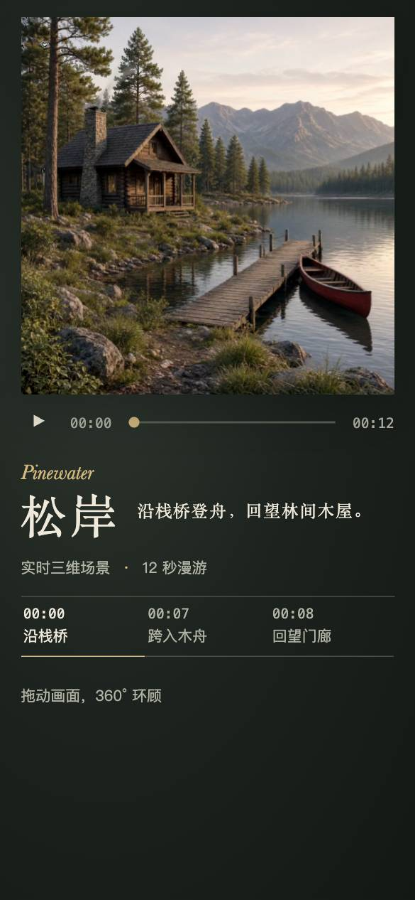

# 松岸 · Pinewater

沿湖畔栈桥走上木舟，再转身回望林间木屋。这个 12 秒的第一人称场景由 Three.js 和 WebGL 2 实时绘制。拖动鼠标或滑动屏幕，就能在同一个时刻转头看向别处。[打开实时场景](https://pinewater-realtime.fomsky.chatgpt.site/)

<a href="https://pinewater-realtime.fomsky.chatgpt.site/"></a>

## 本地运行

需要 Git、Python 3 和支持 WebGL 2 的浏览器。Three.js、场景模型和贴图都随仓库提供，可以直接用静态 HTTP 服务运行。

```sh
git clone https://github.com/icesixgod/pinewater-realtime.git
cd pinewater-realtime
python3 -m http.server 8000 --bind 127.0.0.1 --directory dist
```

在浏览器中打开 [本地场景](http://127.0.0.1:8000/)。部署到其他静态托管服务时，将 `dist/` 的内容作为站点根目录，保留其中的相对路径。

## 操作

| 操作 | 方法 |
| --- | --- |
| 开始或暂停漫游 | 点击画面或播放按钮，也可以在画布获得焦点时按空格 |
| 自由环顾 | 按住鼠标或用单指拖动画面。水平、垂直都能连续转满一圈，漫游时也会保持手动选定的朝向 |
| 恢复原运镜 | 点击「视角复位」，或在画布获得焦点时按 Home |
| 切换时刻 | 拖动进度条，或选择「沿栈桥」「跨入木舟」「回望门廊」。链接可用 `?frame=192` 定位到第 8 秒 |

## 从哪里读代码

- [viewer.js](dist/viewer.js) 处理指针交互、播放时钟、章节切换和画布尺寸。
- [scene.js](dist/scene.js) 装配场景，并使用四元数计算手动视角。[passage.js](dist/passage.js) 定义栈桥到木舟的行走路线和默认镜头。
- [hydrology.js](dist/hydrology.js) 更新水面、倒影和船体运动。[forest.js](dist/forest.js)、[cabin.js](dist/cabin.js) 和 [dockboat.js](dist/dockboat.js) 分别构建树林、木屋和栈桥木舟。
- [surface-capture.js](dist/surface-capture.js) 将参考图中的外观投影到几何表面。[art/](dist/art/) 存放纹理、几何数据与材质。

## 许可证与素材署名

项目自有程序代码采用 [MIT 许可证](LICENSE)。这项授权覆盖原创程序部分。图像、扫描模型、测量与动作数据按各自来源处理，具体出处见[场景素材清单](dist/CREDITS.txt)。

- Three.js r169 及其 Reflector 示例采用上游的 [MIT 许可证](dist/three.LICENSE.txt)。
- Poly Haven 的木材、岩石、植被等素材采用 CC0。Google Scanned Objects 的鞋模型采用 CC BY 4.0，模型在场景中经过缩放、镜像和贴图调整。[鞋履与布料署名](dist/art/walker-CREDITS.txt)
- 步态和落脚缓冲参考 Carnegie Mellon University Motion Capture Database 的 113_25 和 113_19。项目将拟合系数用于镜头运动。[数据出处与致谢](dist/CREDITS.txt)
- 原场景以随附参考图校准构图和表面纹理。原项目未为该参考图单列开放许可证。
